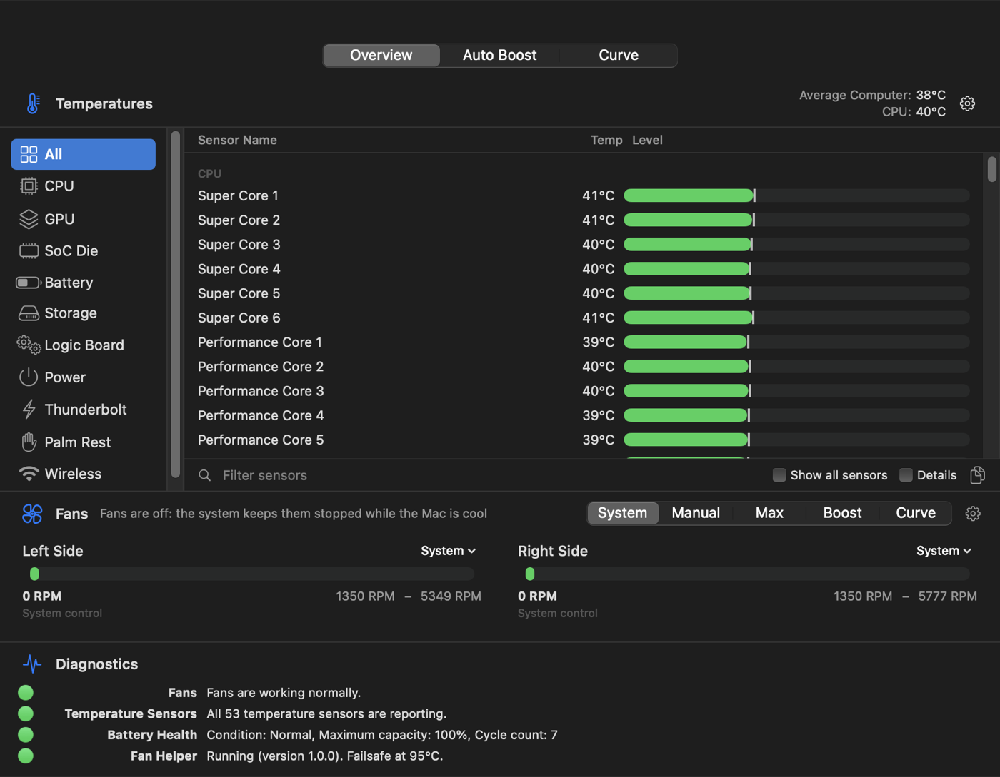
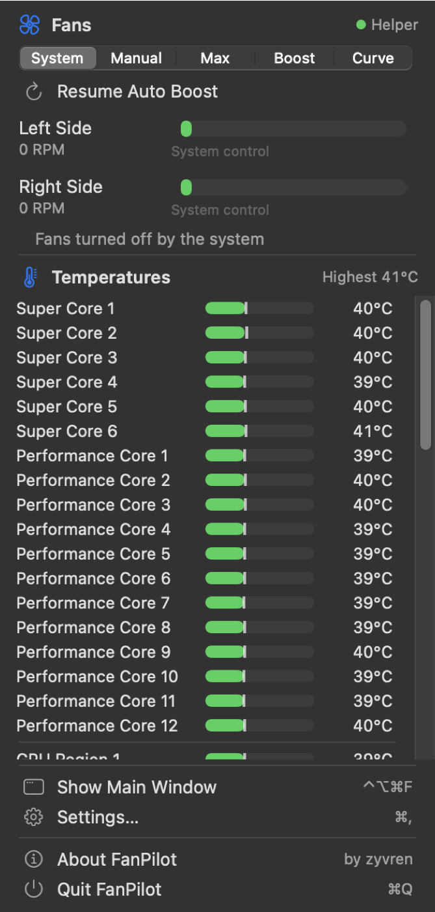
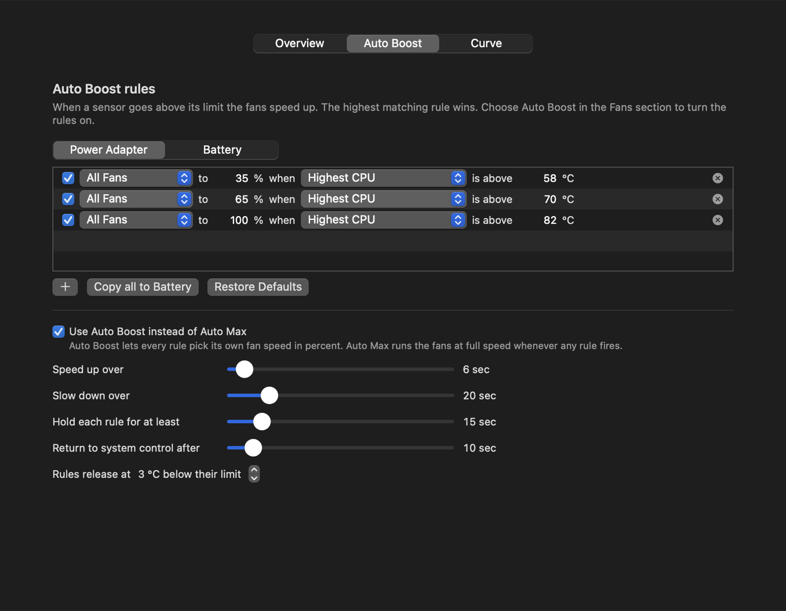
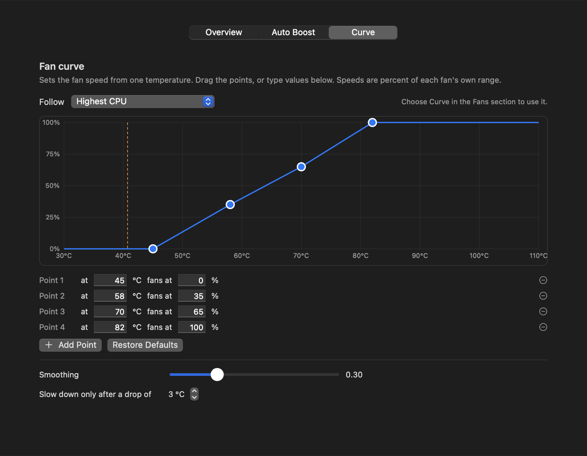
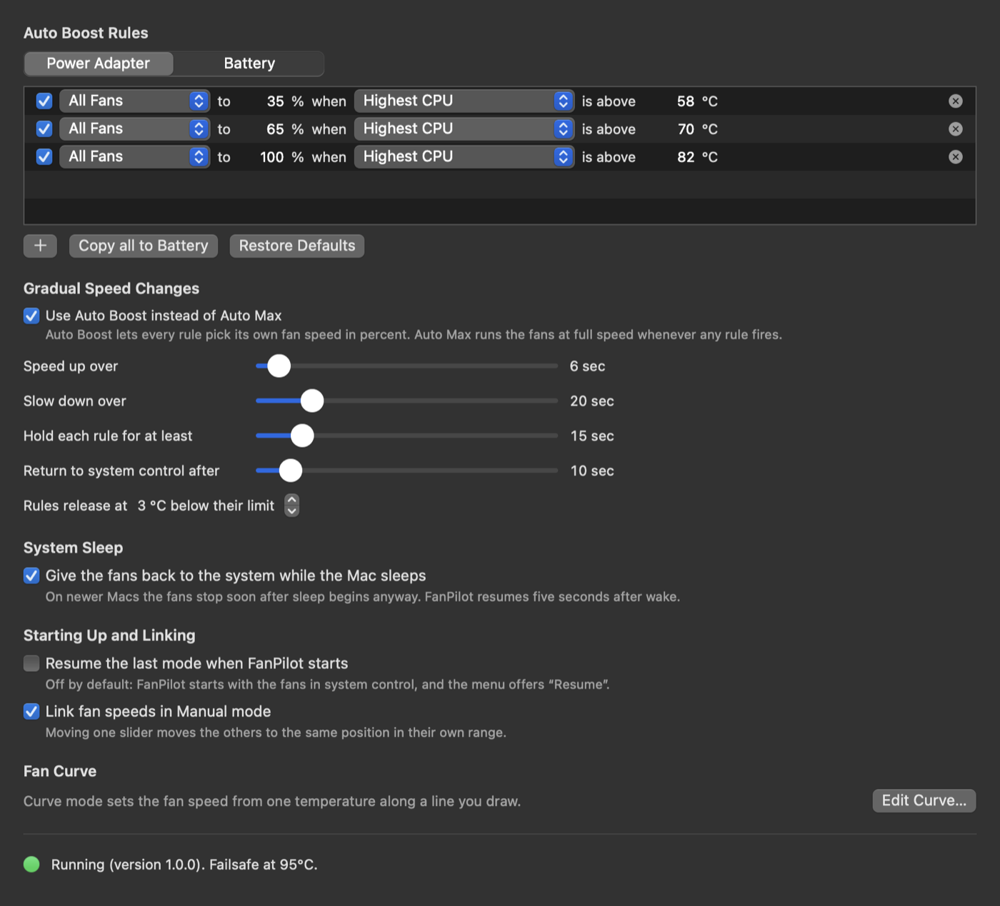
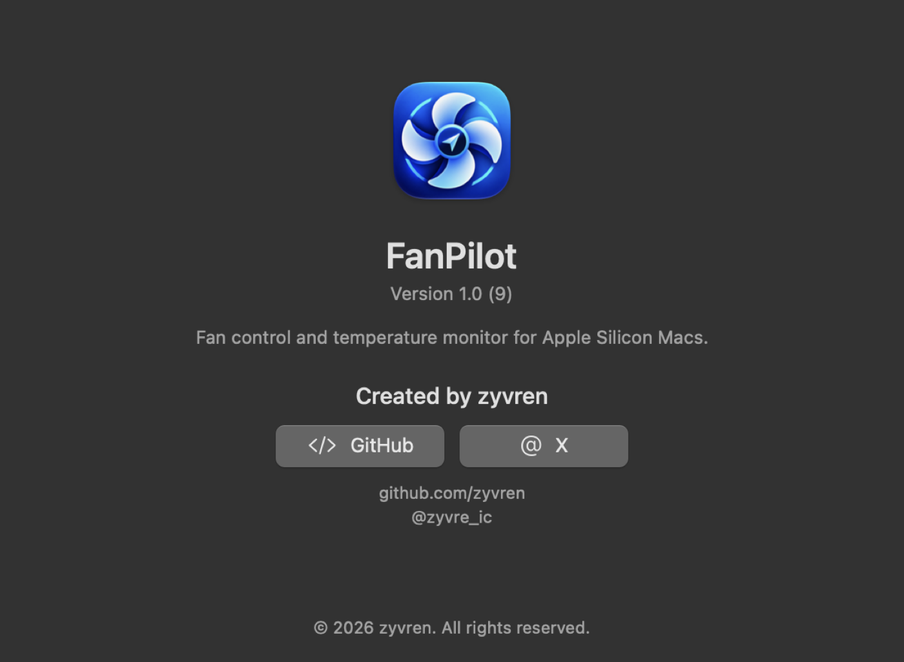
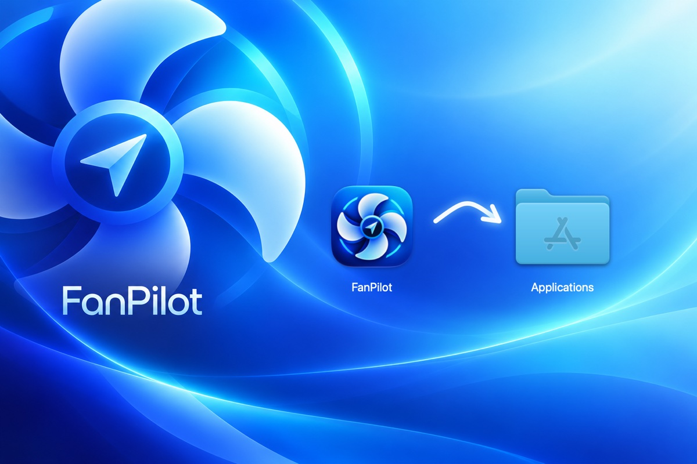

<p align="center">
  
</p>

<h1 align="center">FanPilot</h1>

<p align="center">
  <b>Take control of your Mac's fans.</b><br>
  Live temperatures in the menu bar, every sensor of your Apple Silicon Mac, and fan speed you can set yourself:
  manual, max, temperature rules or your own curve.
</p>

<p align="center">
  <a href="https://github.com/zyvren/FanPilot/releases/latest"></a>
</p>

<p align="center">
  
  
  
  
</p>

<p align="center">
  
</p>

---

## Why FanPilot

Apple Silicon Macs keep their fans off, or very slow, until the chip is already hot. That is quiet, but
when you render, compile or game for a long time your Mac runs warm and may slow itself down.
FanPilot lets you decide:

- **See everything.** CPU cores (named per chip: Super / Performance / Efficiency), GPU, SoC die,
  battery, SSD, power, Thunderbolt, palm rest, wireless, and every other sensor your Mac exposes.
- **Control every fan.** System (macOS decides), Manual (RPM or %), Max, Auto Boost rules, or a
  temperature curve you draw.
- **Stay safe.** A small helper is the only part that writes to the fans. It keeps every speed within
  your fans' real limits, hands the fans back to macOS when the app quits, crashes or the Mac sleeps,
  and forces full speed if the chip ever reaches 95 °C.
- **Free and open source** (MIT). No account, no tracking, no network access.

## Screenshots

<table>
  <tr>
    <td width="50%"></td>
    <td width="50%"></td>
  </tr>
  <tr>
    <td align="center"><b>Overview</b>: every sensor by area, fan speeds, diagnostics</td>
    <td align="center"><b>Menu bar panel</b>: fan modes and all temperatures one click away</td>
  </tr>
  <tr>
    <td></td>
    <td></td>
  </tr>
  <tr>
    <td align="center"><b>Auto Boost</b>: speed up when a sensor passes a limit, per power source</td>
    <td align="center"><b>Curve</b>: drag points to map temperature to fan speed</td>
  </tr>
  <tr>
    <td></td>
    <td></td>
  </tr>
  <tr>
    <td align="center"><b>Settings</b>: gradual speed changes, sleep behavior, linking</td>
    <td align="center"><b>About</b></td>
  </tr>
</table>

## Download and install

1. Download **FanPilot-1.0.dmg** from the [latest release](https://github.com/zyvren/FanPilot/releases/latest).
2. Open it and drag **FanPilot** onto **Applications**.

   

3. Open FanPilot from Applications. It lives in the menu bar (no Dock icon by default).

> **"Apple could not verify FanPilot..."**
> FanPilot is open source and not notarized by Apple (that requires a paid developer account), so
> macOS warns you the first time. Open it once, then go to **System Settings → Privacy & Security**,
> scroll down and click **Open Anyway**. You only do this once.
> Prefer the Terminal? `xattr -dr com.apple.quarantine /Applications/FanPilot.app`

4. **Turn on fan control.** Temperatures work right away. To change fan speeds, FanPilot needs its
   small helper: open **Settings → Helper → Install** (or use the banner in the menu panel) and enter
   your administrator password. Without the helper FanPilot is a temperature monitor.

**Requirements:** a Mac with Apple Silicon (M1 to M5) and macOS 14 Sonoma or later. Macs without fans
(MacBook Air) get monitoring only.

## Features

- **Menu bar:** up to three slots (highest temperature, average CPU, any sensor you pin, fan speed),
  °C or °F, orange and red warning colors.
- **Fan modes:** System, Manual (per fan, in RPM or %, optionally linked), Max, Auto Boost, Curve.
  Boost and Curve ramp up and down smoothly and give the fans back to macOS when they are no longer
  needed.
- **Auto Boost rules:** "fans to 65 % when Highest CPU is above 70 °C", with separate rule sets for
  battery and power adapter, hysteresis so fans do not flap, and an Auto Max variant.
- **Sensors window:** grouped by area, session maximum, search, pin to the menu bar, copy as CSV.
- **Diagnostics:** fans, temperature sensors, battery health, helper status.
- **Notifications** when a temperature passes your limit, **CSV logging** of temperatures and fan
  speeds, **launch at login**, global shortcuts (⌃⌥⌘F main window, ⌃⌥⌘M menu panel).
- **Works per Mac:** fans, their limits and the right control keys are detected at launch; sensor
  names come from a per-model table covering the Apple Silicon line-up, with a fallback classifier for
  models it does not know yet.
- **`fanpilotctl`** command-line tool: `list`, `sensors`, `watch`, `status`, `set 0 50% --hold 30`,
  `max`, `auto all`.

## Safety

Only the helper (`fanpilotd`, a root LaunchDaemon) writes fan settings, and it never trusts what it
is asked to do:

- Every target is **clamped** to the fan's real minimum and maximum, read from the hardware.
- Control is **leased**: if the app stops talking to the helper (quit, crash, hang), the fans return
  to macOS within seconds. The same happens on sleep, on shutdown of the helper, and at every start.
- **Thermal failsafe:** if a CPU, GPU or SoC sensor reads 95 °C or more on two samples in a row, both
  fans go to full speed until the chip has cooled down.
- Every write is **verified** by reading it back, and failures are reported instead of ignored.

If anything ever looks wrong, this hands every fan back to macOS immediately:

```sh
sudo fanpilotctl auto all
```

Restarting the Mac also resets fan control.

## Build from source

Requires macOS 14+, Xcode or the Swift toolchain (Swift 5.10+). No Apple Developer account needed;
everything is ad-hoc signed.

```sh
git clone https://github.com/zyvren/FanPilot.git
cd FanPilot
swift build                      # debug build of every target
swift test                       # unit tests; none of them writes to the hardware
scripts/build_app.sh             # builds build/FanPilot.app (release, ad-hoc signed)
scripts/make_dmg.sh              # packages dist/FanPilot-<version>.dmg (add --build to build first)
```

Install the helper from a source checkout:

```sh
swift build -c release
sudo scripts/install_helper.sh   # installs .build/release/fanpilotd as a LaunchDaemon
fanpilotctl status
```

Reading sensors needs no setup at all:

```sh
.build/release/fanpilotctl list      # fans, limits, live speed
.build/release/fanpilotctl sensors   # temperatures by area (--all, --json)
.build/release/fanpilotctl watch     # live view
```

On a Mac model that has not been tested yet, run the supervised hardware test first:
[`docs/PHASE0.md`](docs/PHASE0.md).

## How it works

```
                         user session                                   root
  +--------------------------------------------+        +--------------------------------------+
  |  FanPilot.app (SwiftUI menu bar app)       |        |  fanpilotd (LaunchDaemon)            |
  |                                            |        |                                      |
  |  FanPilotSensors  -- SMC + HID reads       |        |  HelperServer  <- peer auth (uid)    |
  |    catalog, classifier, aggregates         | NDJSON |  HelperEngine  leases, ownership     |
  |  FanPilotControl  (pure logic)             |  over  |  FanWriter     takeover / release    |
  |    Boost rules, Curve, ramp, RPM math      |  Unix  |  Failsafe      95 C -> fans to max   |
  |  HelperClient  ----------------------------+ socket |  PowerEvents   release before sleep  |
  +--------------------------------------------+ -----> +-------------------+------------------+
  +--------------------------------------------+   /var/run/fanpilot.sock   |
  |  fanpilotctl (CLI, user or root)           | -------------------------> |  read + WRITE
  +--------------------------------------------+                            v
        reads sensors itself, unprivileged                          AppleSMC  fan keys F<n>md, F<n>Tg
                                                                    IOHID     die / NAND / gauge temps
```

Temperatures and fan speeds are read without privileges from the System Management Controller
(AppleSMC) and the IOHID temperature sensors. Changing a fan means switching its mode key to manual
and writing a target speed, which needs root, so only the helper does it. The full design (SMC
protocol, wire protocol, safety rules, control logic) is in [`docs/SPEC.md`](docs/SPEC.md).

| Target | Role |
|---|---|
| `CSMC` | C layer: SMC struct with layout checks, AppleSMC calls, IOHID temperature access |
| `FanPilotKit` | Shared code: SMC codec and client, models, wire protocol, socket framing, settings |
| `FanPilotSensors` | Per-model sensor catalog, classifier, SMC and HID readers, aggregates, diagnostics |
| `FanPilotControl` | Pure control logic: RPM math, Auto Boost, curve, ramps, controller |
| `FanPilotHelperCore` | Helper logic: fan writer, leases, failsafe, socket server, power events |
| `fanpilotd`, `fanpilotctl`, `FanPilotApp` | The helper, the CLI and the app |

## Uninstall

1. In FanPilot: **Settings → Helper → Uninstall** (or `sudo scripts/uninstall_helper.sh` from a
   checkout). The fans go back to macOS first.
2. Quit FanPilot and move it from Applications to the Trash.
3. Optional: `defaults delete com.fanpilot.app` removes the preferences.

## Known limits

- Fan control is verified on a MacBook Pro M5 Pro (`Mac17,8`, macOS 27). Other Apple Silicon Macs
  use the same detection and should work, but have not been tested yet: reports are welcome.
- Sensor names for a few models (`Mac14,8`, `Mac14,14`, `Mac15,14`, `Mac16,9`, `Mac17,5`) are
  incomplete; their missing sensors show up under "Other".
- The release is built for Apple Silicon only. Intel support exists in the code but is untested.
- The app is not notarized (see the install note above), and launch at login may need approval in
  System Settings → General → Login Items.
- Default Auto Boost thresholds (35 % at 58 °C, 65 % at 70 °C, 100 % at 82 °C) are a starting point;
  tune them to your taste.

## Contributing

Issues and pull requests are welcome, especially test reports from other Mac models. Please run
`swift test` before sending a change.

## Credits

Created by **zyvren**: [GitHub](https://github.com/zyvren) · [X (@zyvre_ic)](https://x.com/zyvre_ic)

## License

FanPilot is released under the [MIT License](LICENSE).

FanPilot is an independent project and is not affiliated with Apple or any other fan-control vendor.
Use it at your own risk: it changes how your Mac cools itself.
